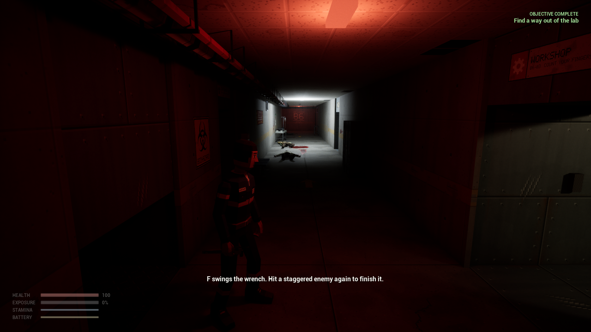
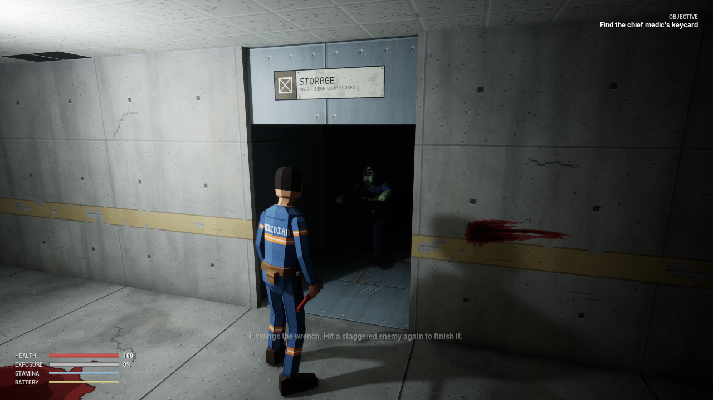
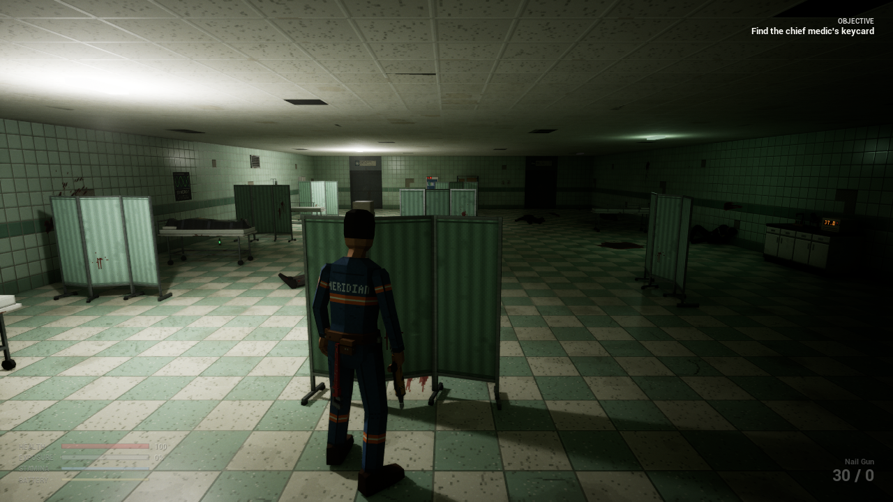

# Containment Breach: Sector 9

Test builds of a single-player, third-person survival-horror shooter. Low-poly characters and chunky pixel-art textures under modern lighting, in the spirit of early-2000s horror games.

**[Download the latest build](../../releases/latest)** (Windows, about 320 MB, nothing to install)

## The game

A classified research program buried beneath a remote facility goes wrong. An experimental compound, R-9, rewrites the staff into something hungry and violent. You are Sam Reyes, a junior facilities technician trapped on the lowest sub-level of *Meridian Deep*, and the only way out is up.

You scavenge, pack what you can carry into a cramped attache case, build weapons out of junk, rescue who you can, and try not to turn while you do it. Ammo is scarce, most of the building is dark, and every bite pushes you closer to becoming one of them.

| | |
|---|---|
|  |  |

## What is in the build

Two levels, about twenty to forty minutes. **B6: Containment Labs & Medical Bay**: crawl out of the sealed lab, find the chief medic's keycard, take the lift. **B5: Maintenance Tunnels**: the power is out; find three fuses in the dark, start the generator, and get back to the lift past everything the lights woke up.

It is an early build of an unfinished game. Every sound was synthesized by a script, the animations are first passes, the only music is on the main menu, and the balance numbers are first guesses. A temporary test loadout (every gun, ammo type and armor piece, including the M4A1 rifle and SPAS-12 shotgun) sits in the first room, behind you as you start.

## How to play

1. Download the zip from the [Releases](../../releases) page and unzip it anywhere.
2. Run `Sector9.exe`. Windows may warn that the app is from an unknown publisher, because the build is not signed: choose "More info", then "Run anyway".
3. If Windows reports missing runtime files, run `Engine\Extras\Redist\en-us\vc_redist.x64.exe` from the unzipped folder once and try again.

**Needs** 64-bit Windows 10 or 11 and a DirectX 12 graphics card, roughly a GTX 1070 / RX 5700 or newer. The first minute may stutter while shaders compile.

## Controls

| | |
|---|---|
| Move, look | WASD, mouse |
| Sprint / crouch | Left Shift / Left Ctrl or C |
| Dodge, vault | Space |
| Aim / fire / reload | Right mouse / left mouse (while aiming) / R |
| Weapons | 1 to 4 |
| Wrench, finisher on a staggered enemy | F |
| Use, pick up, search (hold) | E |
| Attache case and crafting | Tab. Drag items to move them; R, right mouse or the wheel turns the one you are carrying; click to select, double-click to use or draw; Arrange repacks. Click a recipe to craft it. |
| Quick heal | H |
| Flashlight | L |
| Swap shoulder | Q |
| Pause, controls, quit | Esc, then M for the main menu or Q to quit |
| Fullscreen | F5 |

## Feedback

Open an [issue](../../issues) here. The most useful things to hear: where you got lost or stuck, anything too dark to play, fights that felt unfair or too easy, sounds or animations that broke the mood, and your graphics card with a rough frame rate.
