<h1 align="center">Containment Breach: Sector 9</h1>

<b>A third-person survival-horror shooter that starts deep under Philadelphia.</b> 
Single-player. Test builds of an unfinished game, for Windows.

**[Download the latest build](../../releases/latest)** (Windows, about 370 MB, nothing to install)

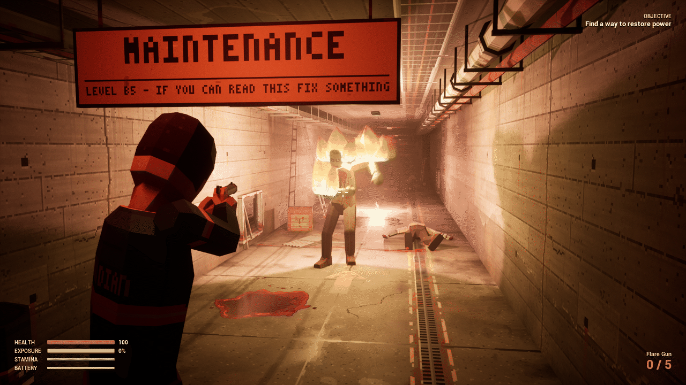

A classified research program buried under Philadelphia has gone wrong. An experimental compound, R-9, has rewritten the staff into something hungry and violent. You are Sam Reyes, a junior facilities technician on the lowest sub-level, with a pipe wrench, one bandage and a working knowledge of the vents. The only way out is up.

It is a slow, dark, close game. Ammunition is scarce and every shot is heard several rooms away. Most of the lamps are dead, dying or red. Every bite adds R-9 Exposure, which makes you hit harder, heal worse and, at 100%, turn. What you carry has to fit in one attache case, and if you die out there all of it stays where you fell.

It looks the way the early 2000s remember themselves: low-poly people and chunky pixel-art textures under modern lighting. It is unfinished: this is a test build with four floors of a planned six levels, and what is rough is listed [further down](#what-is-in-this-build).

- **Four floors.** Containment labs and a medical bay; maintenance tunnels with the power out; a flooded hydroponics hall and the living quarters beyond it; and the facility's own rail depot, where the company's clean-up crew got there first.
- **Seven kinds of infected**, each somebody the outbreak caught at work, each with its own way of getting to you, and two bosses: one who heals every wound you do not burn shut, and one that comes at you from the ceiling.
- **Six weapons and eighteen attachments**, from a pipe wrench and a nail gun built out of scrap to a carbine you fit out at a modification bench.
- **Fire, water and the dark** as things to use and things to survive.
- **A stash, a trader and tasks.** Pack a case, deploy, and at every lift decide whether to go on or get out with what you have.

<table>
<tr>
<td width="33%">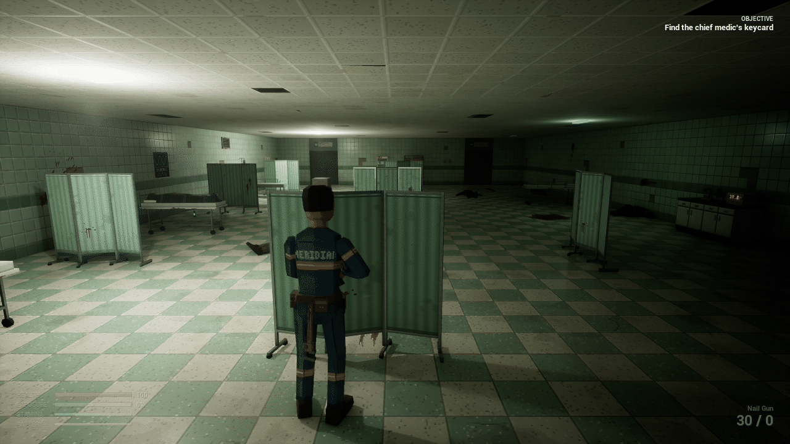</td>
<td width="33%">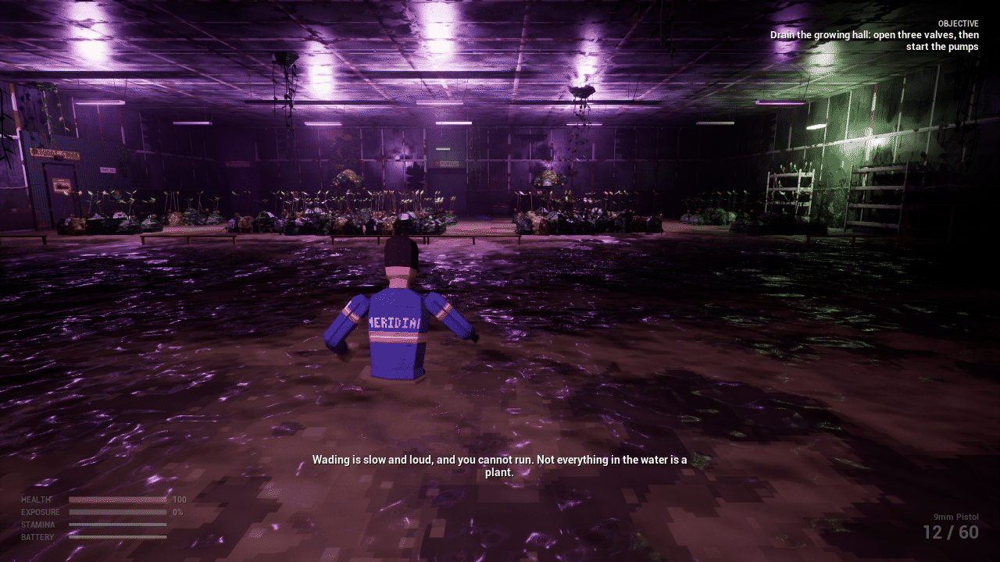</td>
<td width="33%">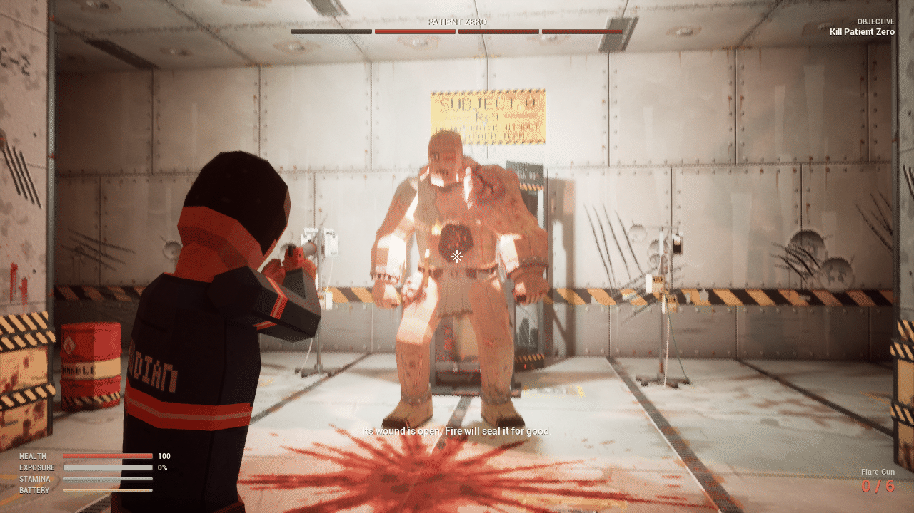</td>
</tr>
<tr>
<td align="center">B6: the medical bay</td>
<td align="center">B4: the growing hall, waist-deep</td>
<td align="center">B5: Patient Zero, one wound open</td>
</tr>
</table>

## Contents

- [Meridian Deep](#meridian-deep): the place, the compound, and the story so far
- [The infected](#the-infected): a field guide, and [Patient Zero](#patient-zero)
- [The arsenal](#the-arsenal): weapons, [attachments](#attachments) and [fire](#fire)
- [Staying alive](#staying-alive): health, Exposure, the dark, noise, the attache case, crafting, armor
- [The Shelter](#the-shelter): stash, deploy, extraction, death, and [Hollis](#hollis-the-quartermaster)
- [The four floors](#the-four-floors)
- [What is in this build](#what-is-in-this-build)
- [Download and run](#download-and-run)
- [Controls](#controls)
- [Feedback](#feedback)

## Meridian Deep

Meridian Deep is a privately run research complex dug deep under Philadelphia. The public story is geothermal energy for the city's district heating, and nobody living above it knows what the lower block is for. The lower block, Sector 9, is where the company was developing **Compound R-9**: a gene therapy meant to make soldiers regenerate and shrug off trauma.

R-9 works too well. It keeps the body running after the mind has stopped, and what is left is violent and hungry. What a host becomes depends on who they were: the lab staff are quick and twitchy, the guards and maintenance crews shamble, and the people who spent their days on a headset still have something to say.

It is about 2003. The monitors are CRTs, the doors want keycards, and the safety board in the lab counts 0 days since the last containment incident.

You are **Sam Reyes**, a junior facilities technician on B6, the lowest sub-level. Sam knows the power, the vents and the doors, which is how a technician comes to crawl out of a sealed lab, build a nail gun out of scrap and get through service routes nobody else would try. Sam is nobody's idea of a soldier. Wounds do not heal on their own, and they show.

**The story so far.** Sam comes round in a sealed lab on B6 with the power out, leaves through the maintenance vent, and takes the chief medic's keycard to the lift. B5, the maintenance level, is dark: three fuses and a generator bring the lights back, along with everything that was lying still in the tunnels, and the lift's breaker turns out to be in the containment arena with Patient Zero, the first person R-9 was ever given. On B4 the way up has been sealed from above. The people who can ask for it to be opened are barricaded into a bunk room at the far end of the floor with a radio, and the man who answers it is the one who sealed them in:

> "B4? ... Okoro. Security, B3. We sealed you in. Those were the orders. I am sorry."

That is where the current build ends. Planned and not built: one more level under the ground, the facility's train depot, whose line runs up to the Broad Street Line, and then the city. By the time Sam gets to the top the outbreak has already broken out of the bunker into Philadelphia, and the police and the military are trying to hold it back and failing. The last two levels are meant to be there, at night: open districts with more than one way across them, and buildings you can go into, an apartment block, a basement, a police station.

## The infected

Seven kinds are in the game now, counting the two bosses. Every one of them is somebody, the uniform tells you who, and who they were tells you what they will do. All of them see and hear, gunfire best of all, and nearly everything they do to you adds R-9 Exposure as well as a wound.

<table>
<tr>
<td width="250" valign="top">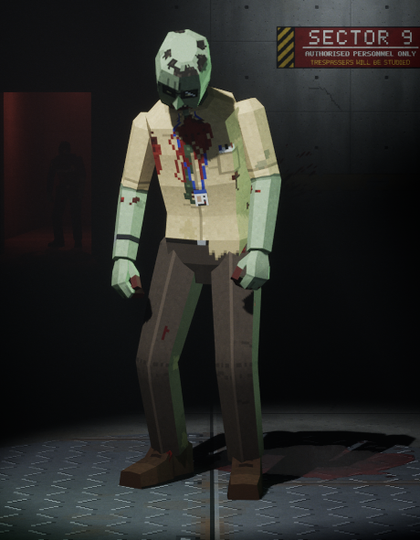</td>
<td valign="top">

### Shambler

*General staff: guards, maintenance crews, hazmat teams, cooks, gardeners. Slow. Low threat alone, deadly in groups.*

R-9 keeps the body walking after the mind has clocked out. A Shambler walks at whatever it saw or heard, takes hold and bites, and every bite is a wound plus Exposure. They are rarely alone and they come to the sound of gunfire. They do not open doors. They have not needed to.

**Dealing with one.** Alone, it is work for the pipe wrench: enough damage in a short time leaves it reeling, and F again finishes it for no ammunition. A head shot counts two and a half times. A shut door is a wall to it. The ones in hazmat suits do not burn.

</td>
</tr>
<tr>
<td width="250" valign="top">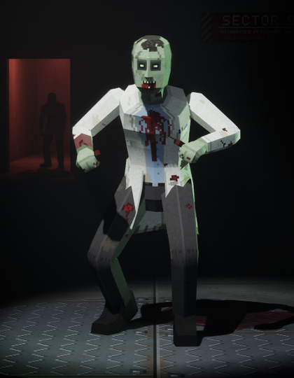</td>
<td valign="top">

### Runner

*Lab staff, still in the coat. Fast, with about half a Shambler's health.*

Quick people; R-9 kept the quick. A Runner weaves as it closes, so it is hard to keep a sight on, then stops dead and coils before it leaps.

**Dealing with one.** That pause is your window: sidestep with Space and it sails past. They break more easily than the others, and fire kills one before it has finished burning.

</td>
</tr>
<tr>
<td width="250" valign="top">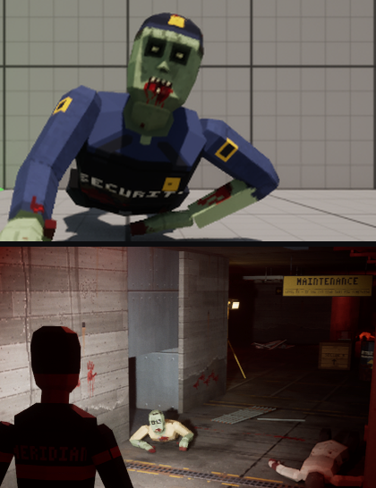</td>
<td valign="top">

### Crawler

*Anybody, from the knees up. Lives in vents, crawl spaces and under desks. First met on B5.*

Sixty centimetres high. A Crawler drags itself along slowly until you are within about four metres, and then it scuttles, three quarters as fast as Sam jogs. It goes where you can only go on hands and knees, lies under standing water without minding, and waits among the dead until something warm is three or four metres off. It leaves a smear where it has dragged itself, and the smears lead somewhere.

**Dealing with one.** Aim lower than you want to. Read the floor before you read the room. Back out of its last four metres or meet it there on purpose. Fire kills it outright.

</td>
</tr>
<tr>
<td width="250" valign="top">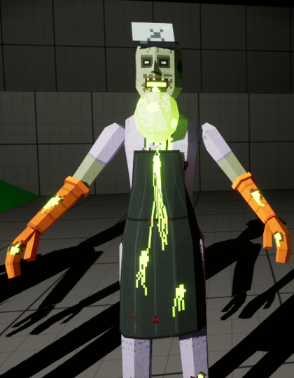</td>
<td valign="top">

### Spitter

*Medical and chemical staff: the apron and the gloves. Keeps its distance. B4.*

A Spitter does not want to be near you. It holds six to twelve metres off, backing away if you close, and when it has the range it retches, its throat swelling and brightening for most of a second, and lobs a slow glob of acid on an arc. The glob carries more than twice the Exposure of a bite, and it leaves a pool that goes on hurting, and exposing, whatever stands in it for five seconds.

**Dealing with one.** The glow is the tell: move when it swells. The glob is slow enough to sidestep and the pool is small enough to walk round. Use cover and close the distance: inside two and a half metres it cannot spit at all, and all it has left is a shove.

</td>
</tr>
<tr>
<td width="250" valign="top">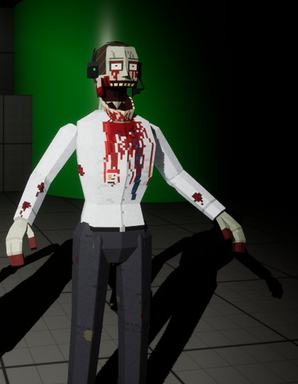</td>
<td valign="top">

### Screamer

*Communications staff, headset still on. Never attacks. Kill it first. B4.*

A Screamer cannot hurt you. It wakes everything that can. When it sees you it takes a breath, and then it shrieks for three seconds: every infected within twenty-five metres, through walls, is roused, sent straight at you, and quickened, a third faster and a quarter harder-hitting until about twelve seconds after the shriek ends. Each of them pulses red while it lasts. Then the Screamer runs, keeps its distance, and does it again fifteen seconds later.

**Dealing with one.** See it before it sees you, and kill it in the breath: do that and nothing has heard. One pistol round staggers it, which cuts a shriek short and takes the quickening off the others. Somebody daubed DON'T LET IT SCREAM beside the canteen door on B4. They were right.

</td>
</tr>
</table>

**Things they all do.**

- **Some are not dead.** Not every body on the floor is finished. Dormant hosts lie among the corpses, or sit slumped at a canteen table, until something comes close, or the lights come back, or the water they were lying under drains away. One takes a moment to get up and can do nothing until it has. Use the moment, or stop walking past bodies.
- **Some are waiting.** An ambusher stands deaf and blind behind a shut door and rushes whoever opens it.
- **They feel it.** Every hit that does not kill makes them flinch from the side it came from, stops them for a moment and knocks them back. A killing shot to the head or a limb takes it off.
- **They stay.** Bodies, blood and what came off them remain where they fell.

### Patient Zero

<table>
<tr>
<td width="250" valign="top">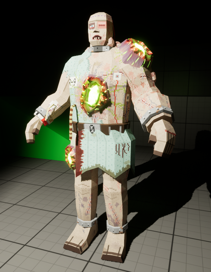</td>
<td valign="top">

*Subject 0. The first person given R-9. The boss of B5, in the containment arena off the generator hall.*

He stands over three metres, he is still wearing the gown and the restraint cuffs, and he heals. His health is four wounds. Empty one and it splits open, he drops to a knee, and for seven seconds the wound stands open and glowing. Set fire to him in that window, with a flare that hits him or the burning fuel of a drum under his feet, and that wound is sealed for good. Miss the window and it knits shut and that part of his bar refills; leave him unhurt for a few seconds and it starts to grow back anyway. Four sealed wounds kill him.

He has a swing, a two-fisted slam that draws a warning ring on the floor, and a charge. Lead the charge into a wall or one of the four pillars and he is stunned; lead it into a fuel drum and it bursts under him. Each wound sealed makes him faster and his warnings shorter.

**Dealing with him.** Bullets open him, and only fire closes the account. Bring the flare gun (one lies beside the arena door, and the flare cabinets hold more flares), count your flares against four wounds, and keep a pillar between you and the charge. If you would rather not, B5 has a second way out.

</td>
</tr>
</table>

### The Stalker

<table>
<tr>
<td width="250" valign="top">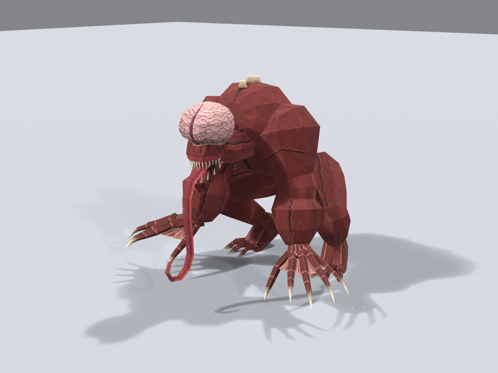</td>
<td valign="top">

*Whatever took the response team apart. The boss of B3, the Train Depot.*

Skinless, eyeless, with its brain out in the air and a mouth full of needles. It goes on all fours, and it goes on the walls and the ceiling as readily as the floor, faster than you can run. It likes to be above you. When it is, it screeches, and then it drops.

On the floor it will not stand still to be shot: aim at it and it is somewhere else. It rakes with its claws, and when it has had enough of the floor it runs for the nearest wall and climbs back out of reach.

**Dealing with it.** Hit it hard while it clings to a wall or the ceiling and it falls, and for a couple of seconds it is down. That is the moment. The response team left a rifle on the platform: find it before you start the train.

</td>
</tr>
</table>

**Planned, not built:** more kinds are intended for the city, among them the Brute (security guards: armored from the front, charges, breaks doors), and more bosses. Which of them, and where, is being decided again now that the plan ends in the streets of Philadelphia.

## The arsenal

You start with a pipe wrench. Everything else is found, built, bought or brought back. Up to four guns ride in quick slots 1 to 4, each also takes its own footprint in the case, and they reload from what you are carrying and nothing else.

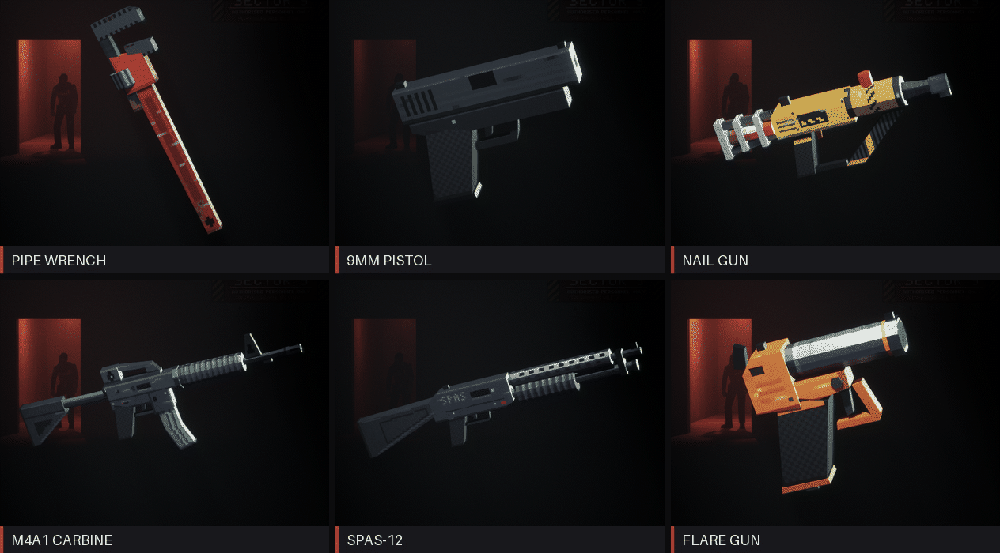

| Weapon | What it is | What it is for | The catch |
|---|---|---|---|
| **Pipe wrench** | Facilities issue, eighteen inches. Never breaks, never needs loading. You always have it. | Lone Shamblers, saving ammunition, and the finisher: stagger something, press F again, and it is dead for free. | A swing costs stamina, and it is used at arm's length from things that bite. |
| **9mm pistol** | Security sidearm, twelve rounds. Accurate. | The all-rounder. Head shots, Screamers, one fuel drum at a time. | Loud: every shot is heard about thirty metres away, which is several rooms. Rounds are scarce, though a schematic lets you make them at a workbench from gunpowder and scrap. |
| **Nail gun** | A framing nailer with the safety defeated, built at a workbench from scrap and duct tape. Automatic, thirty nails. | Quiet work: a nail is heard less than a quarter as far as a pistol shot. Nails are made from scrap anywhere, no bench required. | Weak. A nail does about half what a pistol round does. |
| **M4A1 carbine** | Military, 5.56mm, thirty rounds, fully automatic. Not issued to facilities staff. | The middle distance, and anything that needs to stop now. It takes all six kinds of attachment. | Heard further off than the pistol, hungry, and seven cells long in the case, so decide what you are leaving behind. |
| **SPAS-12** | Pump-action, twelve gauge. Eight pellets a shell, eight shells in the tube. | Whatever is in the doorway. | Pumped between shots and loaded one shell at a time (pulling the trigger stops the loading and fires what is in it). The loudest thing you can carry: about fifty metres. Seven cells long. |
| **Flare gun** | Emergency signalling pistol, one flare in the breech. | Fire and light. A flare flies slowly on an arc and sticks where it lands: in a host it sets them burning, on the floor it lights twelve metres for about half a minute. It is how Patient Zero's wounds are closed. | One shot, then nearly two seconds to break it open and load the next. A flare on the floor brings the curious to look. Hazmat suits do not burn. |

A few things are true of all of them. A head shot does two and a half times the damage of one to the chest; arms and legs, less. A round that meets a wall at a shallow angle can glance off and keep going. Every shot is a noise with a radius, and things inside the radius come to see.

The pistol can be found on B6 and is in a new profile's stash. The nail gun is built from its schematic or bought. The flare gun is on B5. The M4A1 and the SPAS-12 belong to levels that are not built yet, so for now they are bought from the Quartermaster's restricted racks. Planned and not built: the chainsaw, the stun baton, the fire axe, a rivet shotgun, a grenade launcher, throwables, and a prototype weapon.

### Attachments

Guns have slots: muzzle, sight, stock, foregrip, magazine, tactical. An attachment is an item that takes room in the case until it is on a gun, and it goes on or comes off only at a **modification bench** (there is one on every floor), never in the field. Fitted parts show on the gun, in the hand and in the holster. Within a slot nothing does everything best: the quietest suppressor costs a tenth of the damage, the scope that tightens a shot most is the slowest to raise.

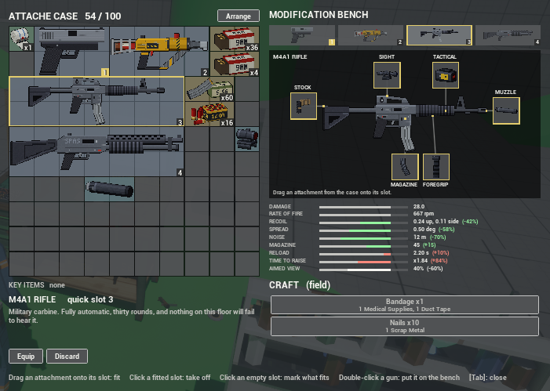

<b>All eighteen attachments</b>

 

| Attachment | Slot | Fits | What it does |
|---|---|---|---|
| 9mm Suppressor | Muzzle | Pistol | A shot is heard a fifth as far and shows no flash. A tenth less damage. |
| 5.56 Suppressor | Muzzle | M4A1 | Heard less than a third as far, no flash, a little less recoil. Slower to raise. |
| Oil Filter Suppressor | Muzzle | Pistol, M4A1 | An engine oil filter on a thread adapter. Heard less than half as far, no flash; throws rounds wider, slower to raise, and bulky in the case. |
| Compensator | Muzzle | M4A1 | Much less recoil. Louder. |
| Full Choke | Muzzle | SPAS-12 | A tighter pattern: more of the shell on one target, less of the corridor covered. |
| Red Dot Sight | Sight | Any gun with slots | Tighter shots. The smallest sight. |
| Holographic Sight | Sight | M4A1, SPAS-12 | Tighter shots and a wider view while aiming. |
| 4x Scope | Sight | M4A1 | By far the tightest shots, through a narrow view that is slow to raise. |
| Padded Stock | Stock | M4A1, SPAS-12 | A quarter less recoil. |
| Skeleton Stock | Stock | M4A1 | A little less recoil, quicker to raise, half the room in the case. |
| Wire Stock | Stock | Nail gun | Bent steel rod and a strip of rubber. Tighter shots. |
| Vertical Foregrip | Foregrip | M4A1, nail gun | Stops the muzzle walking sideways; slightly tighter shots. |
| Angled Foregrip | Foregrip | M4A1 | Less recoil both ways and quicker to raise. |
| Extended Magazine (9mm) | Magazine | Pistol | Eighteen rounds where there were twelve. |
| Extended Magazine (5.56) | Magazine | M4A1 | Forty-five rounds. Slower to change. |
| Magazine Tube Extension | Magazine | SPAS-12 | Two more shells under the barrel. |
| Weapon Light | Tactical | Any gun with slots | A torch on the gun, lit with the flashlight and off the same battery, which it empties half as fast again. |
| Laser Sight | Tactical | Any gun with slots | A red dot on whatever the next shot will hit; slightly tighter shots. |

The pistol has four slots (muzzle, sight, magazine, tactical), the nail gun four (sight, stock, foregrip, tactical), the SPAS-12 five (all but a foregrip) and the M4A1 all six. The flare gun has none. A light or a laser, never both.

### Fire

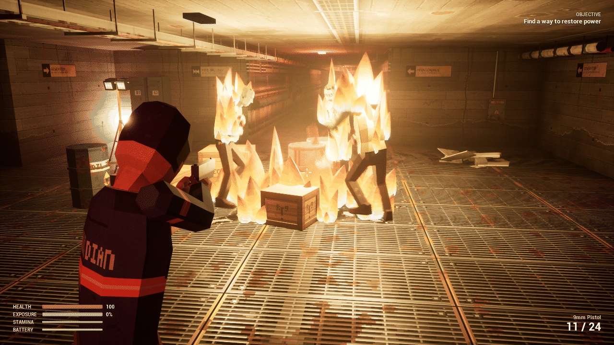

Fire comes from the flare gun and from fuel drums, which burst into three metres of burning ground when any one round hits them. A burning host takes damage for six seconds, enough to kill a Runner or a Crawler and to leave a Shambler with less than half. Shamblers, Runners and Crawlers panic while they burn, blundering about instead of attacking, and a burning body can pass the fire to anything standing within about a metre of it. Sam burns too, briefly.

Fire is also the best light on a dark floor, and it is not quiet: a bursting drum is heard further than a pistol shot.

## Staying alive

**Health and injury.** Health does not come back by itself. A bandage restores a little, a medkit most of what a bad corridor takes, and H uses the most suitable one without opening the case. Below about 60% Sam moves guarded, a hand to one side; below about 30% Sam is doubled over and limping, and slower each time.

**Exposure.** The signature number. Bites, acid and standing in acid all add R-9 Exposure, and it never falls on its own.

| Exposure | What it does |
|---|---|
| Under 40% | Nothing you would notice. |
| 40% to 69% | You hit a tenth harder. |
| 70% to 99% | You hit a fifth harder. Healing items do half as much. |
| 100% | You turn. Your employment ends. |

Only an antiviral injector pushes it back down, and those are mixed at a chem station from a schematic, or bought. The whispers, the things at the edge of the screen and the hallucinations that belong to the upper stages are planned and not built.

**The dark and the flashlight.** The dark down here is not a fault you can report: most of Sector 9's lamps are dead, dying or red, and B5 has no power at all until you restore it. L switches on the lamp on Sam's chest. It drains a battery while it is lit, and a battery pack is about five minutes of light. Decide what you need to see.

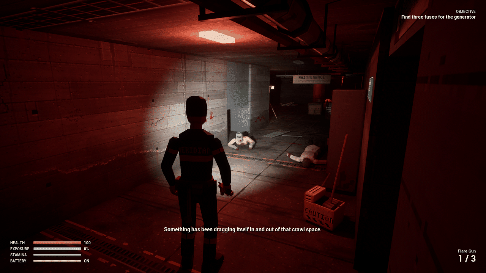

**Noise.** Everything you do has a radius. Crouching is quiet, sprinting is not, and wading through water is as loud as sprinting. A nail is heard about seven metres off, a pistol shot thirty, the shotgun fifty; the generator on B5 and the pumps on B4 are heard sixty metres away, and you are the one who has to start them.

**The attache case.** Everything you carry has to fit in a case ten cells wide and seven deep. A pistol is three cells by two, the long guns seven by two, a medkit two by two, a box of ammunition two by one. Items are dragged about, turned a quarter turn, stacked, thrown on the floor, or repacked for you with Arrange, and a pickup that does not fit stays where it is. Key items and worn armor take no room. **The game does not pause while the case is open.**

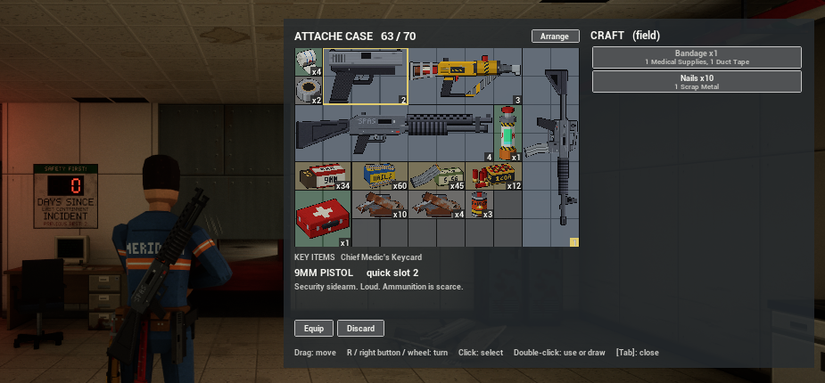

**Crafting.** You know two recipes when the lights go out, bandages and nails, and both can be made anywhere. Everything else is learned from a schematic, lying where somebody dropped it: hardware at a **workbench** (the nail gun, 9mm rounds), medicine at a **chem station** (medkits, antivirals). A recipe once learned is kept, even through death. The parts come out of lockers, crates, cabinets and vending machines, searched by holding E; what a container holds is decided when you first open it and differs every run.

**Armor.** One piece for the body and one for the head. The security vest takes about a third of every hit and the riot helmet a smaller share, each wearing out as it does. Armor is worn the moment you pick it up, shows on Sam, and takes no room in the case. It cannot be repaired yet.

**Safe rooms.** One on each floor. The infected lose track of you inside and will not walk in. Each has a **storage locker** with a pneumatic tube terminal beside it, and what goes into the locker is on its way to your stash (see below).

**Survivors.** Not everyone turned. A few of the staff are still shut in where they hid: a nurse in a side ward on B6, a technician in the control booth on B5, a cook and a botanist behind a barricade on B4. They will not move while the infected are close. Clear the room and a survivor makes for shelter, and leaves you something in the storage locker on the next floor up.

**Saving.** There are no save points. For now the menu has no Continue: a mission you quit part-way cannot be picked up again, and the next Deploy abandons it with everything Sam was carrying. Extract before you stop.

## The Shelter

Between missions you are on the Shelter screen: what you own, what Sam will carry, somebody to trade with and a list of work.

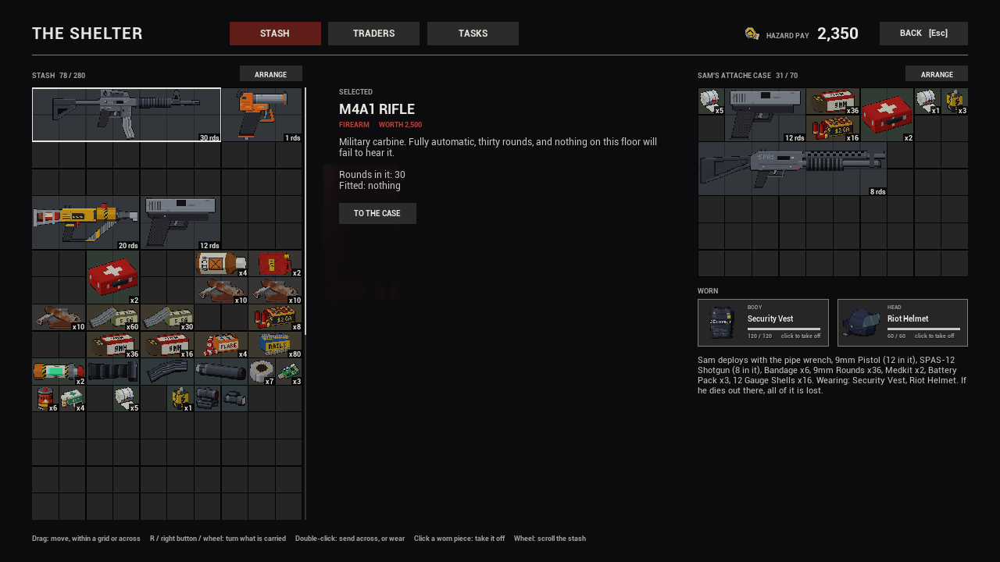

- **The stash** is everything you own and are not carrying. It is never lost.
- **The loadout** is Sam's case and the armor Sam wears, packed from the stash before a mission: at most four guns, one of a kind.
- **Deploy** to any floor you have reached. A new profile has reached B6 only; ride a lift up to a floor once and it is open to you from then on.
- **At every lift, choose.** E rides up to the next floor. X **extracts** to the Shelter with everything you are carrying. The lift you arrived by is not a way out. B5 has a second exit, a service hoist in the control booth that works once the generator is running, so you can leave that floor without meeting Patient Zero.
- **If you die, everything you were carrying is gone.** The stash is untouched, and the next loadout starts as the default kit: the pipe wrench and a bandage.
- **Storage lockers are the stash.** The lockers in safe rooms send things down the tubes. What you put in one is yours for good once you leave the floor by a lift, or die.

<table>
<tr>
<td width="46%" valign="top">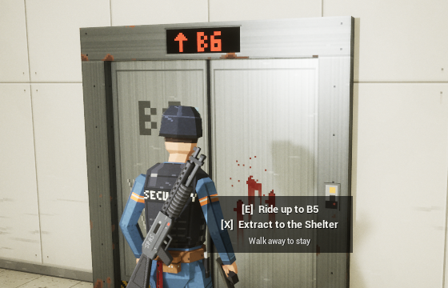</td>
<td valign="top">

**Hazard Pay** is the company's compensation for workplace incidents, and it is the currency.

| For | Hazard Pay |
|---|---|
| Each floor reached in a mission | 100 (the floor you started on pays only if you get out alive) |
| Each boss killed | 250 |
| Each survivor rescued | 50 |
| A task | Its own reward |
| Selling to the Quartermaster | 40% of what the thing is worth |

A new profile starts with a 9mm pistol, 24 rounds, three bandages, a medkit, a battery pack, a little scrap and tape, and 500 Hazard Pay.

</td>
</tr>
</table>

### Hollis, the Quartermaster

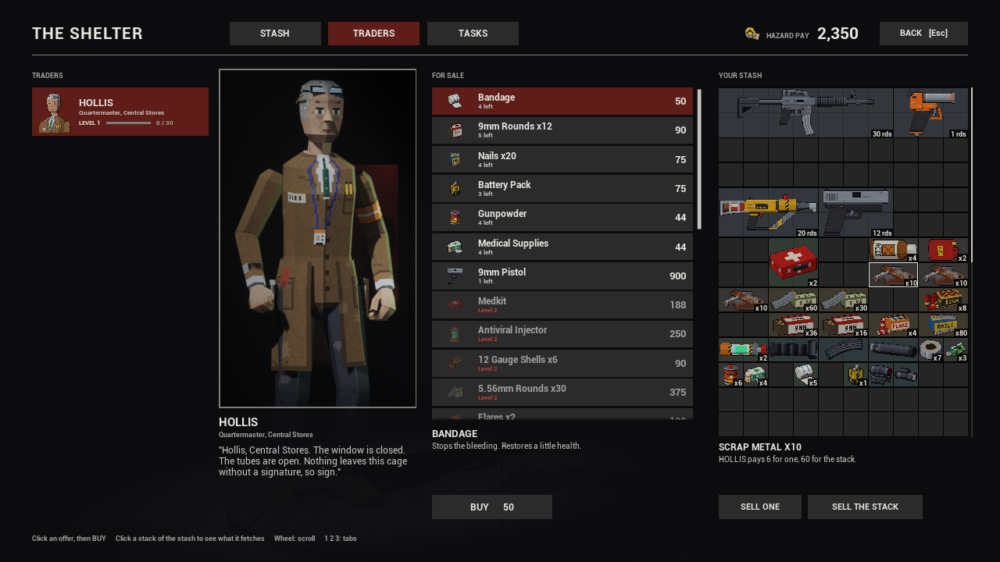

Stores supervisor, twenty-six years' service. When the alarms went she locked herself into the central stores cage on B5 and has seen no reason to come out. She deals through the pneumatic tubes and the dumbwaiters: what goes into a storage locker reaches her shelves, and what she is paid for reaches yours.

> "Hollis, Central Stores. The window is closed. The tubes are open. Nothing leaves this cage without a signature, so sign."

She sells for Hazard Pay, buys anything with a value, and restocks whenever a mission ends. Her shelf opens with your standing, which comes from her tasks: bandages, 9mm, nails, batteries and a pistol to begin with; then medkits, antivirals, the other calibres, flares and a few plain attachments; then the restricted racks, with the flare gun, the SPAS-12, the M4A1 and the military attachments.

<b>Her eight tasks</b>

 

| Task | What she wants | What she pays |
|---|---|---|
| **Signed Out** | "Come back down a lift alive." Extract from a mission once. | 150, two bandages |
| **Shrinkage** | Six scrap metal and two rolls of duct tape, to keep the cage shut. | 250, 24 rounds of 9mm |
| **Pest Control** | Eight Shamblers, with the pipe wrench: "it is signed out to you, and ammunition is a consumable I would have to write off." | 300, a medkit, and the nail gun on her shelf |
| **Stock Take** | The stores ledger, left on B5 where they dropped it when they ran. "Bring it back. Do not read it." | 350, an extended 9mm magazine |
| **Lights On** | Start the generator on B5, then extract from that floor, "so I know the circuit held with somebody standing in it." | 500, twelve shells |
| **Written Off** | Asset PZ-001, "Patient Zero", is loose on B5 and damaging other stock. Write it off. | 1,000, a 9mm suppressor |
| **Wet Stock** | Reach B4, drain the growing hall, and bring back three canisters of nutrient concentrate. "They are sealed. Mostly." | 600, two antivirals |
| **Head Count** | Move three names to "accounted for", in the good column: rescue three survivors. | 800, a security vest |

Things she asks for are handed over from the stash when the task is turned in, so they have to come back with you, or go into a storage locker. Some of them are in a level only while the task is live.

Two more traders are planned and not built: the nurse from B6, for medicine, and Okoro of B3 security, for guns and armor.

## The four floors

### B6: Containment Labs & Medical Bay

<table>
<tr>
<td width="50%"></td>
<td width="50%">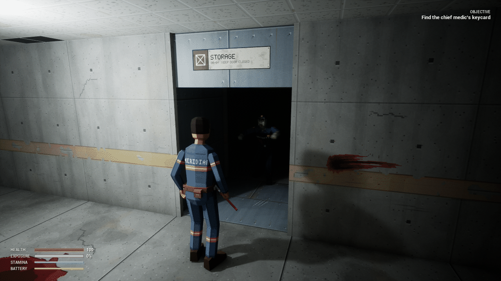</td>
</tr>
</table>

Where Sam wakes. The lab door is sealed and the power is out, so the way out is the maintenance vent. Beyond it: a corridor on red emergency lighting, a workshop with a workbench and the nail gun's schematic, a storage closet somebody shut for a reason, three holding cells you may regret opening, and a medical bay with a chem station, a nurse shut in the side ward, and the chief medic's office at the far end. The medic's keycard opens the lift lobby. Shamblers, Runners, and the first bodies that are not finished.

### B5: Maintenance Tunnels

<table>
<tr>
<td width="50%">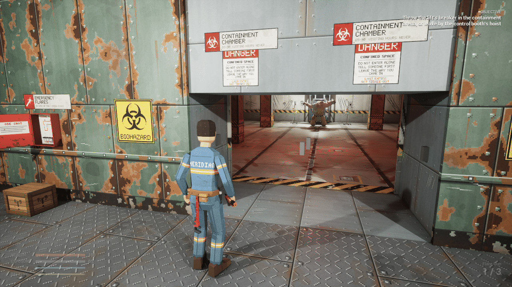</td>
<td width="50%"></td>
</tr>
</table>

No power, low ceilings, and a sign that says IF YOU CAN READ THIS FIX SOMETHING. The lift up is dead. A long tunnel leads to a junction with a spoke each way: a break room (the safe room), an electrical workshop and the foreman's office to the north; the pipe gallery and the generator hall to the east; a flooded tunnel, the parts store and the pump room to the south. The generator needs three fuses, and each costs something different: one is in the Crawler nest, reached on hands and knees; one is in a locked tool cage, where you can see it through the mesh; one is in the pump room, where not every body lying in the water is dead.

Starting the generator lights the whole floor, opens the control booth, wakes everything that was dormant, and brings a few more from where you cannot see. The lift is on a breaker of its own, in the containment chamber off the generator hall. The sign on its door gives the visiting hours as NEVER, and the last entry as not signed out.

### B4: Hydroponics & Living Quarters

<table>
<tr>
<td width="50%"></td>
<td width="50%">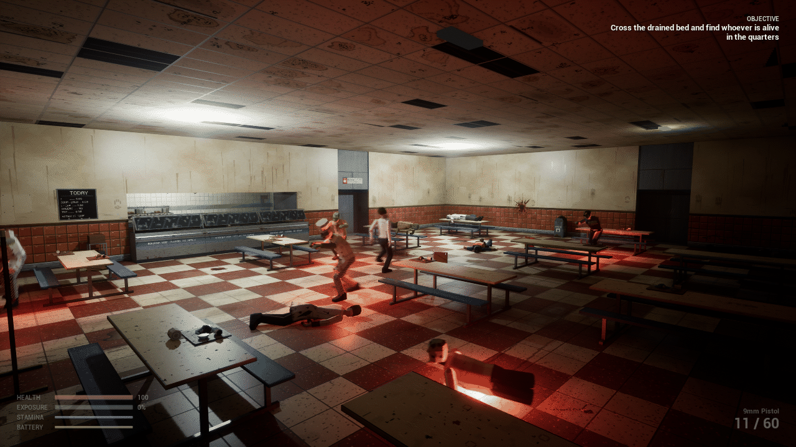</td>
</tr>
</table>

This floor has power. What it does not have is a way up: the lift and the stairs to B3 are sealed. Between the lobby and the living quarters is the growing hall, thirty-six metres by twenty-four under violet grow lights, overgrown and flooded: ankle-deep on the walks, waist-deep down the rows (slow, loud, no running, and things lie in it), and over your head in the reservoir bed that cuts the hall in two. Draining it takes three valves, one of which has lost its hand-wheel, and the pump control. The water goes down over twenty seconds, loudly, and what was lying under it gets up.

Across the drained bed: a canteen with the dead still at their tables, four of whom are not dead, and a Screamer standing where it can see the door. Then the quarters: forty metres of corridor held by Spitters, a recreation room where something is still watching the television, and a door that opens on a wall of furniture with ALIVE INSIDE painted on it.

Above B4 is the Train Depot.

### B3: The Train Depot

<table>
<tr>
<td width="50%">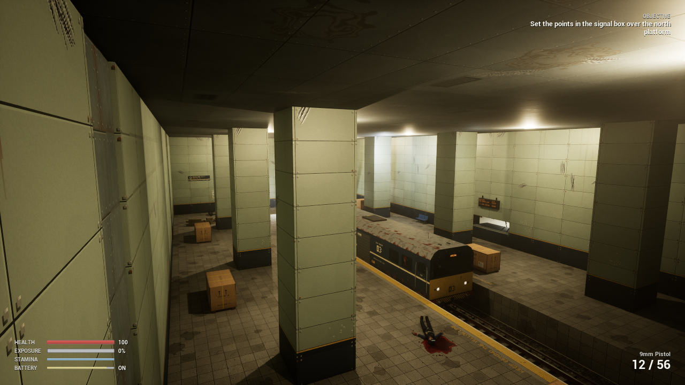</td>
<td width="50%">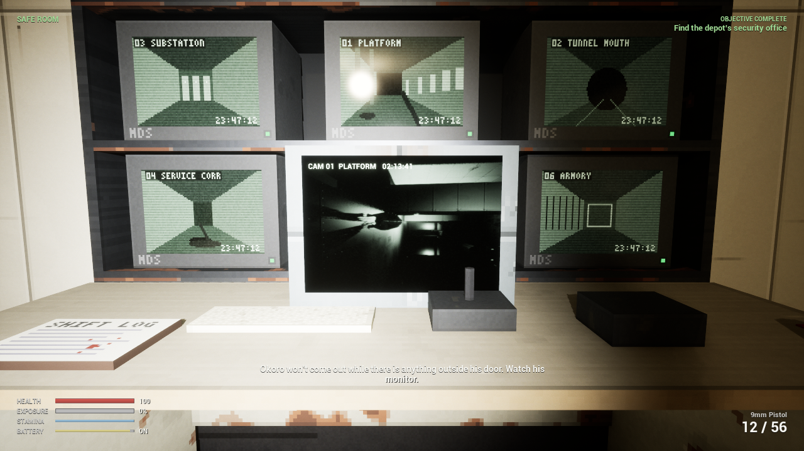</td>
</tr>
<tr>
<td width="50%">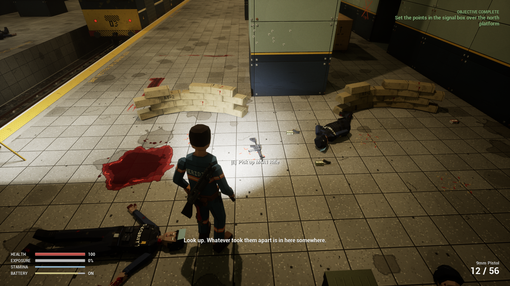</td>
<td width="50%">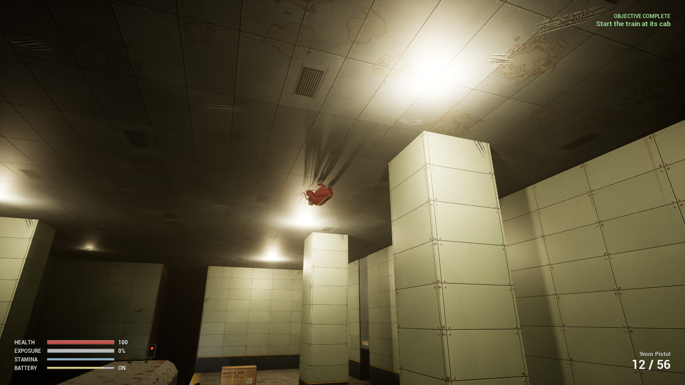</td>
</tr>
</table>

The facility's underground rail depot, and its way out: the line runs up toward the city. The company's response team came down to clean up, and something was waiting for them. You arrive to the sound of the end of it. Their dead are everywhere, in helmets and vests, and some of them have got up again.

Okoro of B3 security, the man who lifted the lockdown over the radio, has barricaded himself in the security office with the camera desk; get him out and he opens the armory. Then the train: traction power at the substation, the points in the signal box over the platform, and the cab. A railcar takes a long time to charge in a hall nine metres high, and the noise brings down what lives on the ceiling. The train will not leave while it is alive.

The train is the only way out of B3, and for now the build ends as it pulls away.

## What is in this build

An early test build. The release page says which version it is and what changed.

- **Four floors**, B6, B5, B4 and B3. The build ends as the train pulls out of B3.
- **The Shelter**: the stash, Sam's loadout, Hollis and her eight tasks.
- **Floors open in order.** A new profile can deploy to B6 only. Ride B6's lift up and B5 is open to you from then on; get to B4 from B5 and so is B4, and the same for B3.
- **A first mission.** On the Shelter screen move the pistol and its rounds from the stash into Sam's case, take Hollis's first task, deploy to B6, find the chief medic's keycard and extract at the lift. That finishes the task.
- **You have what you packed.** Nothing is handed to you on B6. Temporary test racks still stand by the lifts on B5, B4 and B3, with a few guns and some ammunition, so that those floors can be tried on their own; they will go.

It is an early build of an unfinished game, and it shows:

- Every sound was synthesized by a script, and the voices in particular are placeholders. There is almost no music.
- The animations were authored in code and are first passes.
- Every number is a first guess: damage, prices, rewards, how hard it is to get out alive.
- Nobody has played the Shelter with a mouse yet. It has only been driven by a test script.
- Known oddities: B5's lift shows the wrong floor on its indicator, a Crawler's body can poke through a wall it has just passed and the wrench's finisher does not reach one, and what a Screamer does to the others shows only as a red light.

## Download and run

1. Download the zip from the [Releases](../../releases) page and unzip it anywhere.
2. Run `Sector9.exe`. Windows may warn that the app is from an unknown publisher, because the build is not signed: choose "More info", then "Run anyway".
3. If Windows reports missing runtime files, run `Engine\Extras\Redist\en-us\vc_redist.x64.exe` from the unzipped folder once and try again.

**Needs** 64-bit Windows 10 or 11 and a DirectX 12 graphics card, roughly a GTX 1070 / RX 5700 or newer. The first minute may stutter while shaders compile.

There is no Continue for now: quitting in the middle of a mission loses it, so extract before you stop.

## Controls

| Action | Keys |
|---|---|
| Move, look | WASD, mouse |
| Sprint / crouch | Left Shift / Left Ctrl or C |
| Dodge, vault | Space |
| Aim / fire / reload | Right mouse / left mouse (while aiming) / R |
| Weapons | 1 to 4 |
| Wrench, finisher on a staggered enemy | F |
| Use, pick up, search (hold) | E |
| At a lift | E rides up, X extracts |
| Attache case and crafting | Tab |
| Quick heal | H |
| Flashlight | L |
| Swap shoulder | Q |
| Pause, the controls, your active tasks | Esc, then M for the main menu or Q to quit |
| Fullscreen | F5 |

<b>In the attache case, at a bench and on the Shelter screen</b>

 

**The attache case (Tab).** Drag an item to move it. R, the right mouse button or the wheel turns the one you are carrying. Click to select, double-click to use an item or draw a gun. Arrange repacks the case. Click a recipe to craft it. While the case is open R turns the carried item and does not reload, and the game goes on around you.

**At a modification bench.** Drag an attachment from the case onto its slot to fit it. Click a fitted slot to take the part off. Click an empty slot to mark what fits it. Double-click a gun to put it on the bench.

**The Shelter.** Drag items between the stash and the case. R or the right mouse button turns what you carry. Double-click sends an item across, or wears armor. Click a worn piece to take it off. The wheel scrolls the stash. 1, 2 and 3 change tab, Esc goes back. On the TRADERS tab, click an offer and then BUY, or click a stack of the stash to see what it fetches.

Gamepad bindings exist for movement, aiming and the main actions but have had little testing.

## Feedback

Open an [issue](../../issues) here. The most useful things to hear:

- **The loop.** Is losing your gear on death fun or just punishing? Is it clear what extracting does? Are Hollis's prices and rewards anywhere near right? Did any task leave you unsure what to do?
- **The Shelter screen with a real mouse:** dragging, turning, selling.
- **The usual.** Where you got lost or stuck, anything too dark to play, fights that felt unfair or too easy, sounds or animations that broke the mood, and your graphics card with a rough frame rate.
